<div align="center">


<h1>🌡️ 여행온도</h1>

**여행은 즐겁게, 지갑은 안전하게!<br />관광지 후기에서 식비·숙박비·응대·혼잡도를 한눈에 보고, 직접 다녀온 경험을 나누는 여행 준비 서비스**


<br />

<a href="#-화면"></a>

</div>

<p align="center">
  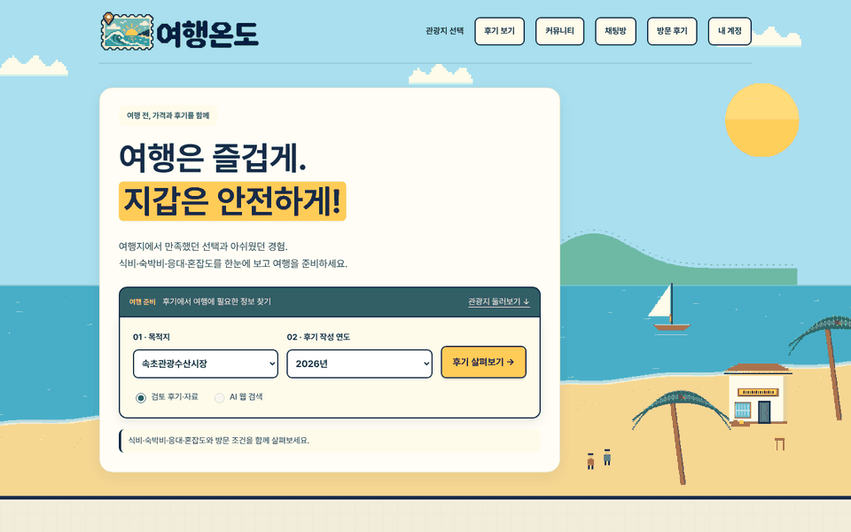
  <br />
  <sub>▲ 실제 서버를 로컬에서 띄워 촬영한 화면 · 메인 → 관광지 선택 → 종합 후기 → 관광지 소개 → 커뮤니티 → 채팅 → 방문 후기 → 로그인</sub>
</p>

---

## 목차

- [프로젝트 소개](#-프로젝트-소개)
- [주요 기능](#-주요-기능)
- [화면](#-화면)
- [기술 스택](#-기술-스택)
- [아키텍처](#-아키텍처)
- [기술적으로 고민한 부분](#-기술적으로-고민한-부분)
- [테스트](#-테스트)
- [실행 방법](#-실행-방법)
- [화면과 API](#-화면과-api)
- [프로젝트 구조](#-프로젝트-구조)
- [자료의 한계](#-자료의-한계)
- [개발자](#-개발자)

---

## 📌 프로젝트 소개

여행지에서 "맛있었다"는 후기는 많지만, **"그 가격이면 괜찮았나", "줄은 얼마나 섰나", "주차는 됐나"** 는 여러 글을 뒤져야 알 수 있습니다.

**여행온도**는 흩어진 후기를 여행 준비에 필요한 기준으로 다시 묶었습니다.

1. **살펴보기**: 관광지와 후기 작성 연도를 고르면 칭찬·불만 언급 수, 키워드, 주요 이슈와 함께 **식비 · 숙박비 · 서비스·응대 · 혼잡·대기** 네 분야의 분위기를 보여 줍니다.
2. **찾아보기**: Gemini **Google Search grounding**으로 디시·펨코·더쿠와 일반 방문 후기를 분야별로 검색하고, **출처가 연결된 문장만** 화면에 올립니다.
3. **나누기**: 직접 다녀온 방문 후기(관리자 승인제), 질문·자유 게시판, 그룹 채팅방으로 여행 이야기를 이어 갑니다.

맛 칭찬을 가격 만족으로 바꾸지 않고, 근거가 없는 분야는 좋은 평가로 채우지 않는 것을 원칙으로 삼았습니다.

> **개인 프로젝트**입니다. 아기자기한 **픽셀 해변** 콘셉트로 화면을 만들었고, 풍경 이미지는 모두 프로젝트에 포함된 SVG입니다.

---

## ✨ 주요 기능

### 🔎 관광지 후기 종합
| 기능 | 설명 |
|---|---|
| **9개 관광지** | 속초관광수산시장 · 경주 황리단길 · 전주 한옥마을 · 부산 해운대 · 제주 동문시장 · 강릉 안목해변 · 대구 서문시장 · 여수 낭만포차거리 · 담양 죽녹원. 지역 탭으로 걸러 봅니다. |
| **연도별 종합 후기** | 후기 **작성 연도** 기준으로 전체 후기 · 칭찬 언급 · 불만 언급 수, 칭찬·불만 키워드, 주요 이슈를 집계합니다. 한 후기의 여러 칭찬은 1건으로 셉니다. |
| **비용과 방문 분위기** | 식비 · 시장 주변 숙박비 · 서비스·응대 · 혼잡·대기 카드. 평일/주말 · 시간대 같은 실제 언급 조건을 함께 보여 주고, 근거가 부족하면 "판단할 후기가 부족해요"로 남깁니다. |
| **검토 자료** | 속초 36건(수동 검토 30건 + 공개 본문 확인 6건), 대구 서문시장 9건. 작성자 이름은 익명 처리합니다. |
| **AI 웹 검색** | Gemini + Google Search grounding으로 네 분야를 **병렬 4건** 요청합니다. 출처·문장 연결이 없는 결과는 오류로 처리하고, 결과를 DB나 브라우저에 쌓지 않습니다. |

### 🗺 관광지 소개 · 방문 가이드
| 기능 | 설명 |
|---|---|
| **속초시장 소개** | 시장 특징, 대표 먹거리 6종, 젓갈·건어물·포장 선물, 5개 골목, 주변 볼거리, 주소·문의·주차 안내 |
| **8개 관광지 가이드** | 장소 소개, 먹거리·체험, 네 분야의 비용·방문 체크, 추천 동선, 방문 정보와 공식 출처. JSON 하나(`destination-guides.json`)를 공통 템플릿으로 렌더링합니다. |
| **후기로 이어지기** | 가이드에서 바로 해당 관광지의 종합 후기와 커뮤니티로 넘어갑니다. |

### ✍️ 직접 방문 후기
| 기능 | 설명 |
|---|---|
| **작성** | 관광지 · 방문일 · 구매 품목 · 지출 금액 · 대기 시간 · 사진과 함께, 식비·숙박비·응대·혼잡 체감을 **각각 독립적으로** 선택합니다(이용하지 않은 항목은 평가하지 않음). |
| **관리자 승인** | 등록 직후 `PENDING`. 관리자가 승인·반려(사유 필수)하며, 승인된 글을 수정하면 다시 검토 대기로 돌아갑니다. |
| **별도 집계** | 승인된 직접 후기만 외부 수집 자료와 **구분해서** 홈 화면에 집계합니다. |

### 💬 커뮤니티 · 채팅
| 기능 | 설명 |
|---|---|
| **질문 · 자유 게시판** | 관광지 태그(선택) · 분류(음식·숙박·주차·교통·입장·쇼핑·대여·편의시설·기타) · 검색 · 페이지 구분. 사진 1장(JPG/PNG, 5MB) 첨부 |
| **도움됐어요 · 저장** | 회원당 1회 도움 반응(다시 누르면 취소), 본인만 보는 저장한 글 목록 |
| **관리자** | 글 숨김 · 다시 공개 · 삭제, 댓글 삭제. 다른 사람 글 내용은 수정할 수 없습니다. |
| **그룹 채팅방** | 방 만들기 → 초대 링크로 참여, 방별 별명, 실시간 전달 · 이전 대화 조회, 방장의 내보내기 · 방 닫기, 최대 5회 자동 재연결 |

### 🔐 회원 · 후원 · 관리자 도구
- 아이디 회원가입 + **네이버 · 구글 소셜 로그인** (Client ID/Secret이 설정된 제공자만 버튼 표시)
- 닉네임(2~16자, NFKC 정규화 · 대소문자 무시 중복 방지), 공개 화면에는 로그인 ID를 노출하지 않음
- **카카오페이 자율 후원**: "커피 한 잔으로 응원하기" → 결제 준비 → 승인 검증 → DB 저장
- **Ollama 후기 분석(관리자 전용)**: 후기 한 편을 붙여 넣으면 로컬 LLM이 시스템 프롬프트 · JSON 스키마에 맞춰 경험을 추출

---

## 📸 화면

<table>
  <tr>
    <td align="center"><b>메인 · 관광지와 연도 선택</b></td>
    <td align="center"><b>어디로 떠나볼까요? (9개 관광지)</b></td>
  </tr>
  <tr>
    <td></td>
    <td>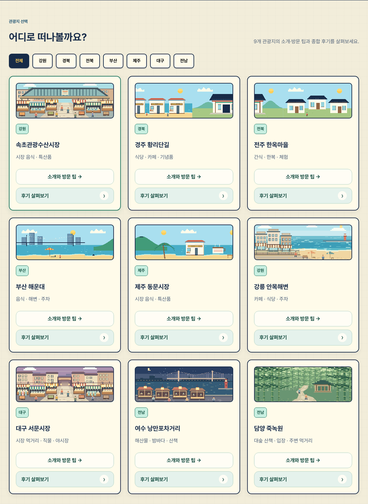</td>
  </tr>
  <tr>
    <td align="center"><b>여행지 종합 후기 · 비용과 방문 분위기</b></td>
    <td align="center"><b>속초관광수산시장 소개</b></td>
  </tr>
  <tr>
    <td>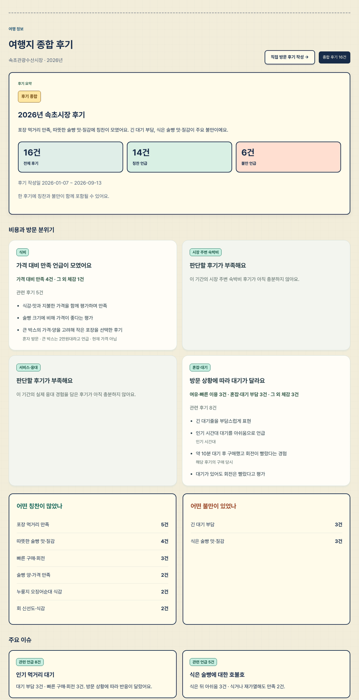</td>
    <td>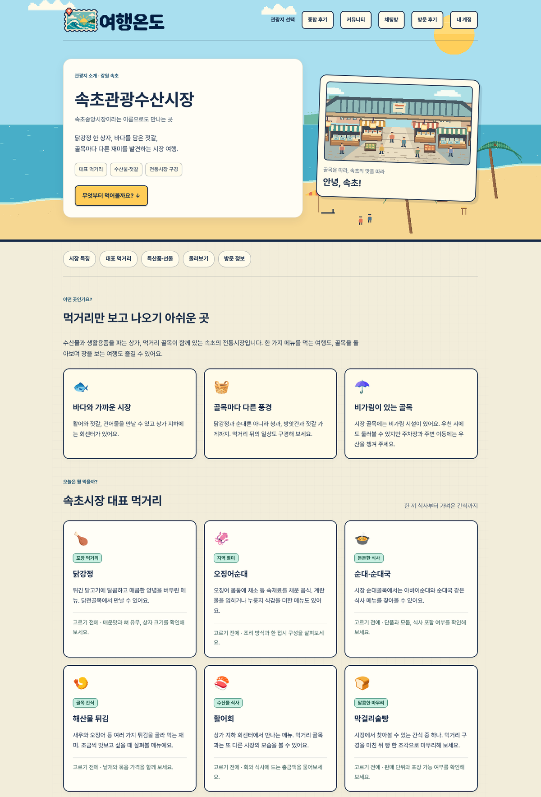</td>
  </tr>
  <tr>
    <td align="center"><b>관광지 가이드 (경주 황리단길)</b></td>
    <td align="center"><b>커뮤니티 · 도움됐어요 · 저장</b></td>
  </tr>
  <tr>
    <td>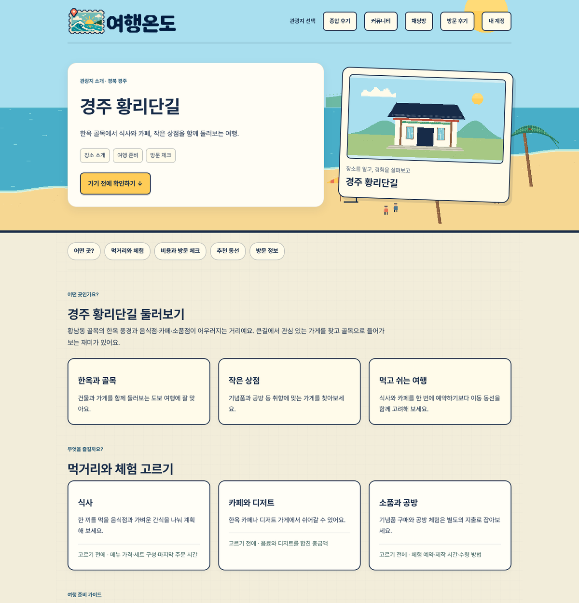</td>
    <td>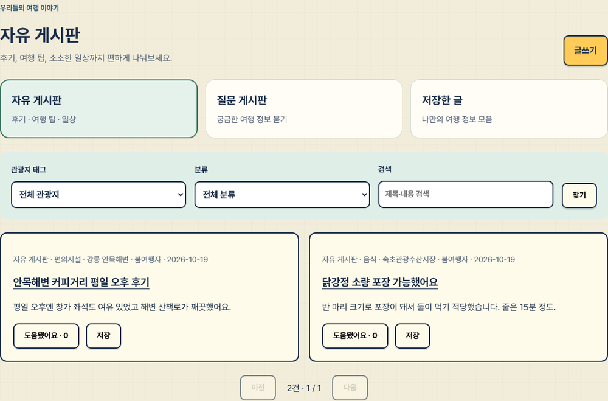</td>
  </tr>
  <tr>
    <td align="center"><b>직접 방문 후기</b></td>
    <td align="center"><b>그룹 채팅방</b></td>
  </tr>
  <tr>
    <td>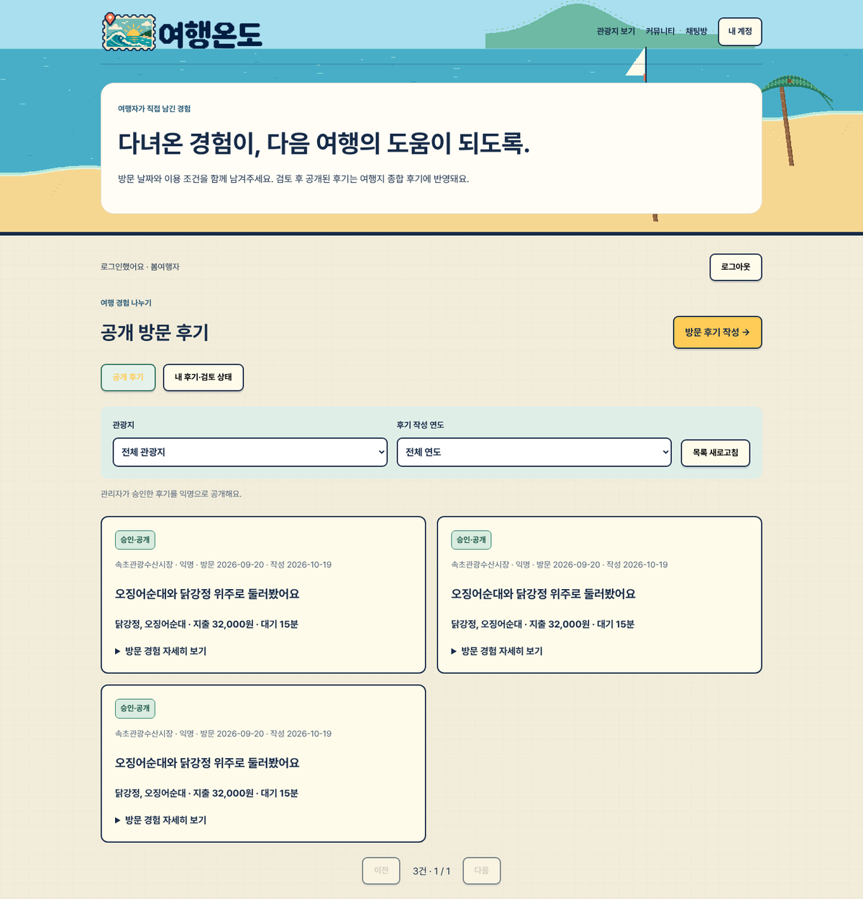</td>
    <td>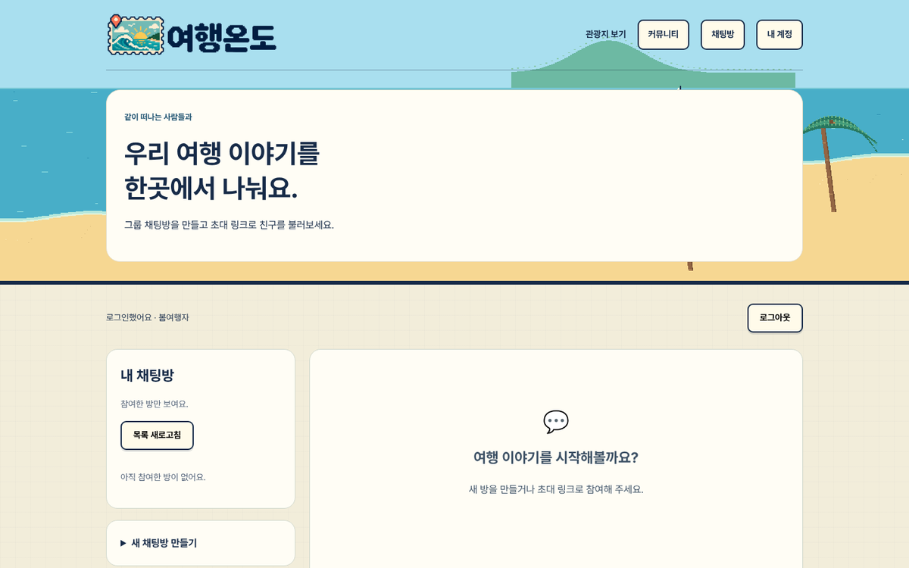</td>
  </tr>
  <tr>
    <td align="center"><b>로그인 · 회원가입</b></td>
    <td align="center"><b>카카오페이 후원</b></td>
  </tr>
  <tr>
    <td>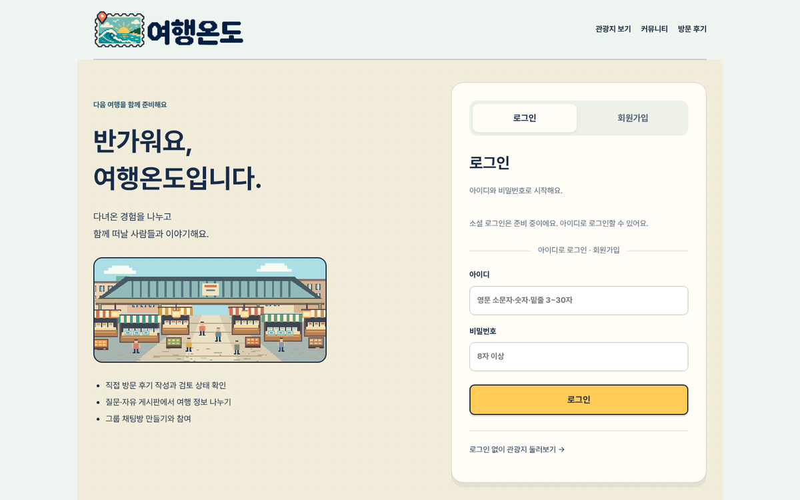</td>
    <td>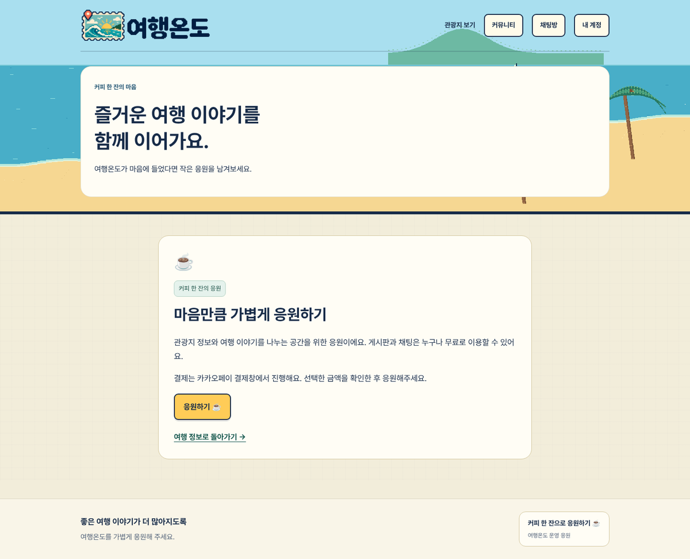</td>
  </tr>
</table>

<table>
  <tr>
    <td align="center"><b>모바일 홈</b></td>
    <td align="center"><b>모바일 속초시장 소개</b></td>
    <td align="center"><b>모바일 커뮤니티</b></td>
  </tr>
  <tr>
    <td align="center">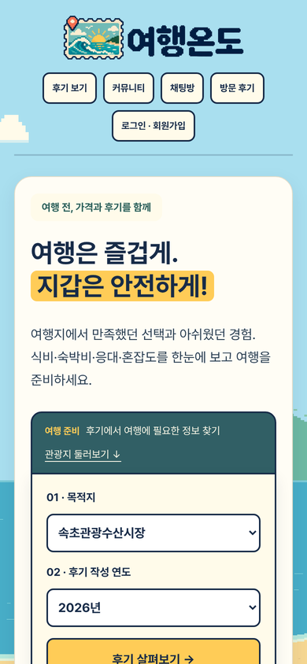</td>
    <td align="center">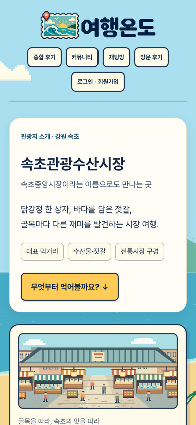</td>
    <td align="center">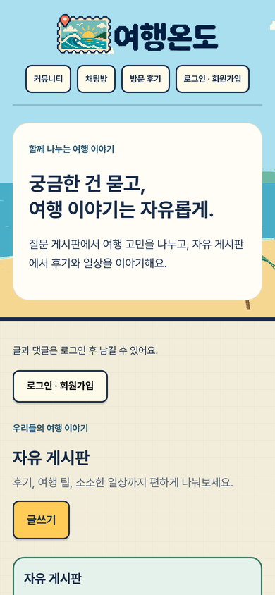</td>
  </tr>
</table>

> 실제 서버를 로컬(H2 메모리 DB)에서 띄워 브라우저로 촬영했습니다. 종합 후기의 검토 자료는 저장소에 포함된 실제 자료이고, 커뮤니티 글 · 방문 후기는 촬영용 예시 데이터입니다.

---

## 🧰 기술 스택

| 영역 | 기술 |
|---|---|
| **Backend** | Java 17+ (Java 25 사용 가능), Spring Boot 3.5 (Web, Data JPA, Validation, Security, OAuth2 Client, WebSocket), Thymeleaf |
| **Auth** | Spring Security 세션 인증 + CSRF, BCrypt, OAuth2 (Naver / Google) |
| **Data** | MySQL 8 (JPA `ddl-auto=update`), 정적 검토 자료 JSON, 업로드 사진은 서버 폴더 |
| **AI** | Gemini API + Google Search grounding, Ollama 로컬 LLM (기본 `gemma12b`) + JSON 스키마 구조화 출력 |
| **결제** | 카카오페이 결제 준비 · 승인 API (TEST CID `TC0ONETIME`) |
| **Frontend** | HTML, CSS, 기본 JavaScript (빌드 도구 없음), Pretendard v1.3.9 웹폰트, 픽셀 아트 SVG |
| **Test** | JUnit 5, Spring Boot Test, Spring Security Test, H2, 모의 Gemini · Ollama · 카카오페이 서버, Node.js 화면 동작 테스트 |
| **CI** | GitHub Actions (`./mvnw test` + `node --check` + JS 테스트) |

---

## 🏗 아키텍처

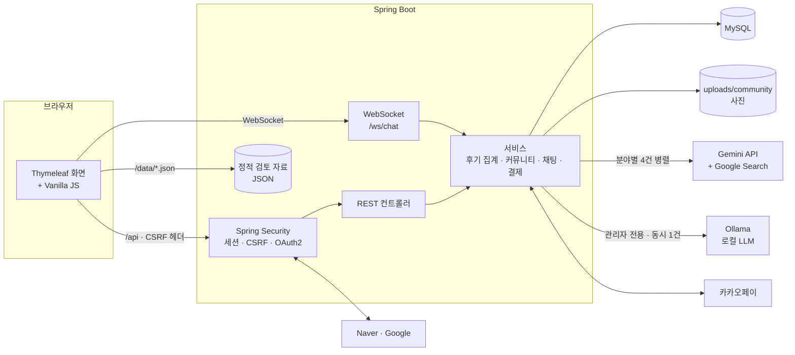

- AI 웹 검색 흐름:

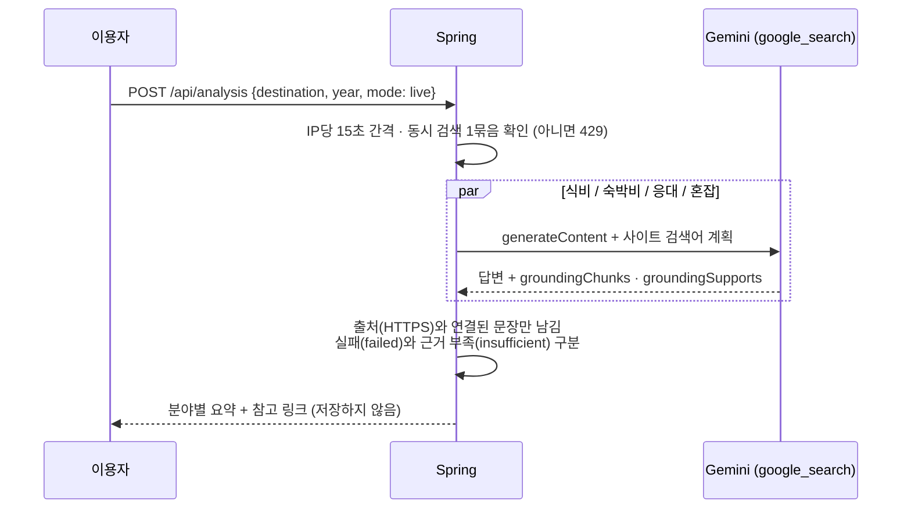

- 직접 방문 후기 상태:

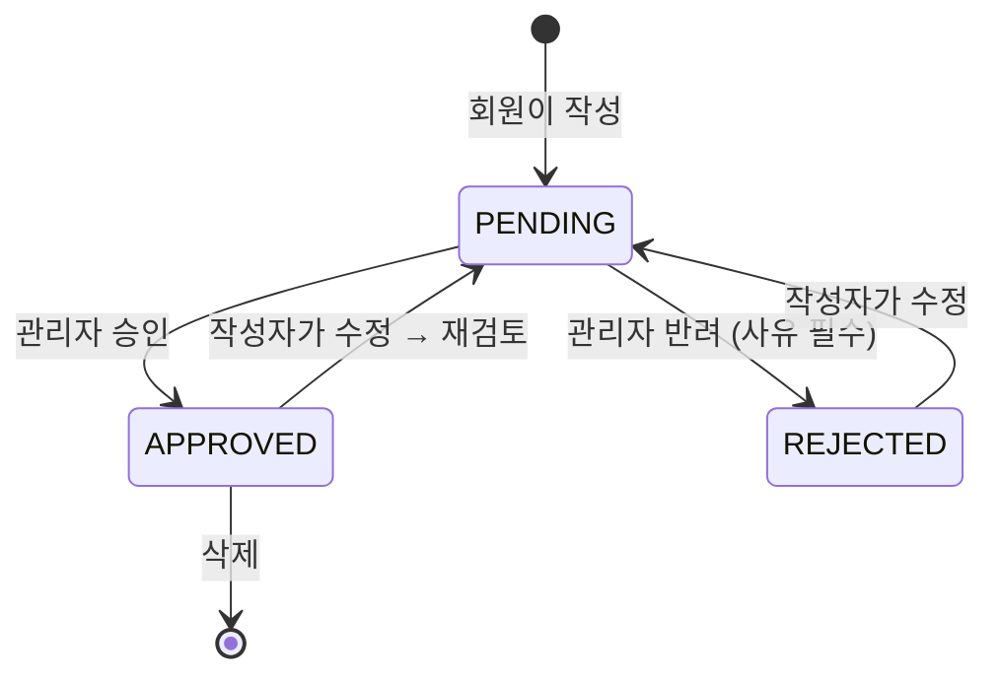

---

## 💡 기술적으로 고민한 부분

<details>
<summary><b>1. "맛있다"를 "싸다"로 바꾸지 않는 집계 기준</b></summary>

- 후기에는 맛 · 양 · 가격 · 대기가 한 문장에 섞여 있어, 단순 긍정/부정 분류로는 "맛있었다"가 가격 만족으로 잡혔습니다.
- 경험을 **영역**(음식 · 숙박 · 주차 · 교통 …)과 **판단 주제**(가격 대비 만족 · 추가 비용 · 혼잡 · 응대 …)로 나눠 추출하고, 맛만 칭찬한 글은 식비 카드에 넣지 않습니다.
- 같은 후기의 여러 칭찬은 1건, 여러 불만도 1건으로 셉니다. 한 후기에 칭찬과 불만이 함께 있으면 각각에 포함하되, 중립 · 혼합 의견을 임의로 긍정 · 부정으로 바꾸지 않습니다.
- 인파 · 대기의 존재만으로 불만이라 판단하지 않고, 한 가게의 줄을 시장 전체의 혼잡으로 확대하지 않습니다. 1~2건은 "개별 경험"으로 표시합니다.
</details>

<details>
<summary><b>2. AI 웹 검색 결과를 믿을 수 있게: grounding 검증</b></summary>

- 모델에게 검색어를 줬다고 해서 그 사이트를 실제로 검색했다는 보장은 없습니다. 요청한 검색어와 API가 돌려준 실제 검색어(`webSearchQueries`)를 **따로 기록**합니다.
- `groundingSupports`가 답변 문장과 안전한 HTTPS 출처(`groundingChunks`)에 연결된 내용만 게시하고, 인용 없는 문장은 요약에서 뺍니다.
- 분야별 **실패**와 **근거 부족**을 구분해, 실패한 분야를 "한산하다 · 친절하다"로 채우지 않습니다. 출처 링크 수를 방문자 수나 후기 수로 표시하지 않습니다.
- Google 검색 제안 HTML은 스크립트 · 동일 출처 권한이 없는 sandbox iframe에 표시합니다.
</details>

<details>
<summary><b>3. 유료 API 호출 보호: 호출 간격과 동시 실행 제한</b></summary>

- 실시간 검색 한 번에 Gemini 요청이 4건 나가므로, 같은 IP는 **15초 간격**, 앱 인스턴스당 **검색 1묶음만** 실행하고 추가 요청은 `429`로 돌려보냅니다(`AtomicBoolean` 기반).
- 로컬 Ollama 분석도 GPU · 메모리 부담을 고려해 동시에 1건만 실행합니다. 관리자 화면 · 분석 API · 상태 API 모두 서버에서 권한을 확인합니다.
- API 키는 서버 환경변수로만 받고, 브라우저 응답이나 소스에 넣지 않습니다.
</details>

<details>
<summary><b>4. 세션 로그인과 CSRF: 로그인 후 토큰 교체</b></summary>

- 화면이 JS에서 API를 호출하는 구조라, 로그인 성공 시 **세션 ID와 CSRF 토큰을 모두 교체**하고 화면도 로그인 · 로그아웃 뒤 토큰을 다시 받아 씁니다(세션 고정 공격 방지).
- 로그인 후 돌아갈 `?next=` 주소는 서버와 브라우저 양쪽에서 **내부 페이지 목록으로 검증**하고, 외부 주소 · API 경로 · 로그인 반복 주소는 홈으로 대체합니다(오픈 리다이렉트 방지).
- 공개 응답에는 회원 아이디 · 회원 ID · 비밀번호 해시를 넣지 않고 `mine`, `canDelete` 플래그로만 버튼 표시를 결정합니다.
</details>

<details>
<summary><b>5. 소셜 로그인: 이메일로 계정을 합치지 않기</b></summary>

- 이메일이 같다는 이유로 기존 계정에 연결하면, 제공자가 확인하지 않은 이메일로 남의 계정에 들어갈 위험이 있습니다.
- 네이버 `response.id` 등 제공자 사용자 ID를 **해시해 제공자와 함께** 계정을 구분하고, 소셜 계정은 별도 일반회원으로 만듭니다. 관리자로 자동 승격되지 않습니다.
- 키가 없는 환경에서도 앱이 실행되도록, Client ID와 Secret이 모두 있는 제공자만 버튼을 표시합니다.
</details>

<details>
<summary><b>6. 카카오페이 후원: 승인 단계의 위변조 검증</b></summary>

- 결제 준비 시 서버가 금액을 정하고 주문을 저장합니다. 돌아온 `pg_token`으로 승인할 때 **주문번호 · TID · CID · 사용자 식별자 · 금액**을 모두 대조한 뒤에만 완료로 저장합니다.
- 이전 토스/모의 주문은 카카오페이 승인에 쓸 수 없게 막았고, 키가 없으면 "결제 서비스 준비 중"으로 표시합니다.
</details>

<details>
<summary><b>7. 방문 후기 동시 수정: 낙관적 잠금과 재검토</b></summary>

- 작성자가 수정하는 동안 관리자가 승인하면, 검토하지 않은 내용이 공개될 수 있습니다.
- 수정 · 삭제 · 검토 요청 모두 현재 `version`을 함께 보내고, 오래된 버전은 **409**로 거절합니다. JPA `@Version` 낙관적 잠금도 적용했습니다.
- 승인된 글을 수정하면 다시 `PENDING`으로 돌아가 공개 · 집계에서 빠집니다. 검토 중 · 반려된 글의 사진은 작성자와 관리자만 볼 수 있습니다.
</details>

<details>
<summary><b>8. 그룹 채팅: 초대 토큰과 참여 상태</b></summary>

- 초대 토큰은 `SecureRandom` 32바이트(64자리 hex)이며 방장에게만 제공합니다. 링크를 받은 사람은 이름과 인원만 미리 보고, 참여해야 대화를 읽을 수 있습니다.
- 참여 관계를 참여 · 퇴장 · 차단 상태로 관리해 **내보낸 계정은 같은 링크로 재참여할 수 없고**, 나간 계정은 기록을 볼 수 없습니다. 닫힌 방은 새 참여 · 송신을 막습니다.
- WebSocket 핸드셰이크에서 로그인 세션을 확인하고, 실시간 메시지와 기록 조회가 겹치면 메시지 ID로 중복을 제거합니다.
</details>

<details>
<summary><b>9. 기존 DB를 깨지 않는 스키마 변경</b></summary>

- 게시판을 질문 · 자유로 나누면서 MySQL enum에 `GENERAL`을 추가하고 관광지 태그를 선택 항목으로 바꿔야 했습니다. JPA `update`만으로는 enum 확장과 NOT NULL 해제가 되지 않습니다.
- `CommunitySchemaUpdater`가 **필요한 경우에만** enum 값을 추가하고 제약을 풀어, 기존 글 · 댓글을 삭제하거나 일괄 변경하지 않았습니다. 기존 REVIEW · REPORT 글은 자유 게시판에 그대로 표시됩니다.
- 닉네임은 nullable unique `nickname_key`(NFKC + 소문자)로 추가해 기존 회원을 유지하면서 DB 수준에서 중복을 막습니다.
</details>

---

## ✅ 테스트

| 구분 | 내용 |
|---|---|
| **백엔드** | JUnit 5 테스트 **81개** (H2): 검토 자료 조회와 지역 · 연도 분리, 입력 검증, 초기 데이터 중복 방지, 출처 없는 AI 응답 차단, 세션 로그인 · CSRF 교체, BCrypt, 본인 글 · 댓글 권한, 관리자 숨김, 사진 형식 · 소유권 · 공개 범위, 방문 후기 승인 · 버전 충돌, 소셜 로그인 복귀, 닉네임, 카카오페이 승인 검증 |
| **실시간** | 실제 HTTP 세션과 WebSocket 연결 사이의 메시지 전달 · 방 격리 · 차단 계정 연결 거부 |
| **외부 연동** | 모의 Gemini · Ollama · 카카오페이 서버로 실제 과금 없이 흐름을 검증 |
| **화면** | Node.js 테스트 10개 파일: 종합 후기 집계, 서문시장 후기, 방문 분위기, 게시판 탭 · 반응, 로그인 페이지, 채팅, 관광지 가이드, 후원 |

```bash
# 백엔드 (H2 사용, MySQL 불필요)
./mvnw test

# 화면 동작 (Node.js)
for f in src/test/js/*.test.cjs; do node "$f"; done
```

> 실제 MySQL 스키마 갱신, 실제 키로 하는 Gemini 검색 · 카카오페이 결제 · 소셜 로그인, 사용자 PC의 Gemma 추출 품질은 각자 환경에서 추가 확인이 필요합니다.

---

## 🚀 실행 방법

### 요구 사항
- JDK 17 이상 (25 사용 가능)
- MySQL 8
- (선택) Gemini API 키, Ollama, 카카오페이 · 네이버 · 구글 개발자 키

### 1. 프로젝트 받기 · DB 만들기

```powershell
git clone https://github.com/JOJOJACK-cmyk/tourist-attraction.git
cd tourist-attraction
```

```sql
-- database/setup.sql 과 같은 내용
CREATE DATABASE IF NOT EXISTS tourist_attraction
    CHARACTER SET utf8mb4 COLLATE utf8mb4_unicode_ci;
```

### 2. 실행

```powershell
# Windows PowerShell
$env:DB_USERNAME="root"
$env:DB_PASSWORD="본인의 MySQL 비밀번호"
.\mvnw.cmd spring-boot:run
```

```sh
# Linux / macOS
export DB_USERNAME=root
export DB_PASSWORD='본인의 MySQL 비밀번호'
./mvnw spring-boot:run
```

**http://localhost:8080** 을 엽니다. 첫 실행 시 JPA가 테이블을 만들고 관광지 · 검토 자료를 넣습니다(다시 실행해도 중복되지 않음). IntelliJ에서는 Run Configuration 환경변수에 같은 값을 넣고 `TouristAttractionApplication`을 실행합니다.

### 3. 환경변수

| 변수 | 용도 | 필수 |
|---|---|:-:|
| `DB_URL`, `DB_USERNAME`, `DB_PASSWORD` | MySQL 연결 (기본 `localhost:3306/tourist_attraction`) | ✓ |
| `APP_ADMIN_LOGIN`, `APP_ADMIN_PASSWORD` | 최초 관리자 생성 (아직 없는 아이디로, 다음 실행부터 지워도 됨) | |
| `APP_UPLOAD_DIR` | 사진 저장 폴더 (기본 `./uploads/community`) | |
| `GEMINI_API_KEY`, `GEMINI_MODEL` | AI 웹 검색 (기본 `gemini-2.5-flash`) | |
| `OLLAMA_BASE_URL`, `OLLAMA_MODEL` | 관리자 후기 분석 (기본 `http://localhost:11434`, `gemma12b:latest`) | |
| `OLLAMA_TIMEOUT_SECONDS`, `OLLAMA_CONTEXT_SIZE` | 응답 제한 시간(300초) · 컨텍스트 크기(16384) | |
| `NAVER_*`, `GOOGLE_*` (Client ID / Secret) | 소셜 로그인 | |
| `KAKAOPAY_SECRET_KEY`, `KAKAOPAY_PAYMENT_MODE`, `KAKAOPAY_CID`, `PAYMENT_SITE_URL` | 카카오페이 후원 (기본 TEST · `TC0ONETIME`) | |

> `.env.example`은 변수 설명용입니다. Spring Boot는 `.env` 파일을 자동으로 읽지 않으므로 PowerShell `$env:` 또는 IntelliJ 환경변수로 설정합니다.

<details>
<summary><b>기능별 설정 안내</b></summary>

| 기능 | 문서 |
|---|---|
| AI 웹 검색 · 방문 분위기 | [docs/ai/visitor-experience-overview.md](docs/ai/visitor-experience-overview.md) · [Gemini Google Search](https://ai.google.dev/gemini-api/docs/generate-content/google-search) |
| Ollama 후기 추출 | [docs/ai/review-extraction.md](docs/ai/review-extraction.md) · [Ollama API](https://docs.ollama.com/api/chat) |
| 속초 프롬프트 적용 예시 | [docs/ai/sokcho-prompt-pilot.md](docs/ai/sokcho-prompt-pilot.md) |
| 커뮤니티 · API | [docs/community.md](docs/community.md) |
| 직접 방문 후기 | [docs/direct-visit-reviews.md](docs/direct-visit-reviews.md) |
| 관광지 가이드 | [docs/destination-guides.md](docs/destination-guides.md) |
| 로그인 페이지 · 닉네임 | [docs/login-page.md](docs/login-page.md) · [docs/member-nicknames.md](docs/member-nicknames.md) |
| 네이버 · 구글 로그인 | [docs/social-login.md](docs/social-login.md) |
| 그룹 채팅 | [docs/group-chat.md](docs/group-chat.md) |
| 카카오페이 후원 | [docs/kakaopay-support.md](docs/kakaopay-support.md) |
| 검토 자료 원문 · 기준 | [속초](docs/research/sokcho-market-review-pilot-2026-09-30.md) · [서문시장](docs/research/seomun-market-review-pilot-2026-10-08.md) · [속초시장 소개](docs/research/sokcho-market-introduction.md) |

</details>

<details>
<summary><b>Ollama로 후기 분석하기 (관리자)</b></summary>

```powershell
$env:OLLAMA_MODEL="gemma12b:latest"
$env:OLLAMA_BASE_URL="http://localhost:11434"
.\mvnw.cmd spring-boot:run
```

관리자 계정으로 로그인한 뒤 `/admin/reviews`에서 후기 **한 편**(최대 4,000자)을 붙여 넣고 분석합니다. 로컬 모델은 인터넷 글을 수집하지 않으며, 입력과 결과를 DB에 저장하지 않습니다. 서버는 구조 · 허용값 · 출처 ID · 날짜를 확인하지만, 내용의 사실성이나 익명화의 완전성을 보증하지는 않습니다.

</details>

---

## 🧭 화면과 API

| 화면 | 주소 |
|---|---|
| 관광지 · 연도 선택, 종합 후기 | `/` (`/?destination={slug}#report`) |
| 관광지 소개 | `/destinations/sokcho`, `/destinations/{gyeongju·jeonju·busan·jeju·gangneung·seomun·yeosu·damyang}` |
| 커뮤니티 | `/community?board=free`, `/community?board=question`, `/community?saved=1#board` |
| 직접 방문 후기 | `/visit-reviews` · 관리자 `/admin/visit-reviews` |
| 그룹 채팅 | `/chat` |
| 로그인 · 회원가입 | `/login`, `/login?mode=signup` |
| 후원 | `/support` |
| 관리자 후기 분석 | `/admin/reviews` |

| 주요 API | 동작 |
|---|---|
| `GET /api/destinations` | 관광지 목록 |
| `GET /api/status` | AI 연결 여부 |
| `POST /api/analysis` | 검토 예시(`sample`) 또는 실시간 분석(`live`) — `{"destinationId":"sokcho","year":2026,"mode":"sample"}` |
| `GET /api/visit-reviews/summary` | 승인된 직접 후기 집계 |
| `GET·POST /api/community/posts` | 게시글 목록 · 작성 (`kind`, `category`, `q`, `page`, `saved`) |
| `PUT·DELETE /api/community/posts/{id}/helpful · /saved` | 도움됐어요 · 저장 |
| `POST /api/reviews/extract` | 관리자 Ollama 단일 후기 추출 |

전체 API는 각 기능 문서에 정리했습니다.

---

## 📁 프로젝트 구조

```
tourist-attraction
├── src/main/java/com/travelprice/
│   ├── api/            # 화면 · REST 컨트롤러, 요청 · 응답 모델, 예외 처리
│   ├── chat/           # WebSocket 허브 · 핸드셰이크(세션 확인)
│   ├── config/         # Security, OAuth2, WebSocket, 초기 데이터, 관리자 생성, 스키마 보정
│   ├── domain/         # 관광지 · 근거 · 회원 · 게시글 · 댓글 · 반응 · 사진 · 채팅 · 방문 후기 · 후원
│   ├── repository/     # Spring Data JPA
│   └── service/        # 후기 집계, Gemini 검색, Ollama 추출, 커뮤니티, 채팅, 카카오페이, 가이드 카탈로그
├── src/main/resources/
│   ├── templates/      # index · destination-guide · destination-sokcho · community · chat · visit-reviews · login · support · admin
│   ├── static/         # css · js · images(픽셀 SVG) · data(검토 자료 JSON)
│   ├── data/           # destination-guides.json
│   └── prompts/        # 후기 추출 · 방문자 검색 시스템 프롬프트, 출력 JSON 스키마
├── src/test/
│   ├── java/           # 통합 · 단위 테스트 (H2, 모의 외부 서버)
│   └── js/             # 화면 동작 테스트 (Node.js)
├── database/setup.sql
├── docs/               # 기능별 안내, AI · 리서치 자료, screenshots
└── .github/workflows/test.yml
```

---

## ⚠️ 자료의 한계

- 검토 자료는 공개 글을 수동으로 확인해 짧게 정리한 **표본**입니다. 현재 판매 가격이나 관광지 전체 평점 · 통계가 아니며, 작성일과 방문일이 다를 수 있습니다.
- 속초 저장 예시는 기존 검토 요약을 시스템 프롬프트 형식으로 정리한 결과이며, 실제 Ollama 호출 결과가 아닙니다.
- 관광지 소개의 추천 동선 · 체크리스트는 여행 준비 제안입니다. 가변적인 가격 · 운영시간은 고정하지 않고 공식 공지 확인을 안내합니다.
- 네이버 원문 크롤러를 구현한 프로젝트가 아니며, 각 플랫폼의 저장 · 재가공 조건을 따릅니다.
- Spring Boot 3.5.x는 학습용 1차 구현 버전입니다. 공개 서비스 운영 전 지원 중인 버전으로 업데이트하고, 사용자 인증 기반 전체 호출량 제한을 추가해야 합니다.

**글꼴**: [Pretendard v1.3.9](https://github.com/orioncactus/pretendard) — Copyright (c) 2021 Kil Hyung-jin, with Reserved Font Name Pretendard. SIL Open Font License 1.1.

---

## 👤 개발자

| | 이름 | 담당 |
|:-:|:-:|---|
| <a href="https://github.com/JOJOJACK-cmyk"></a> | **JOJOJACK**<br />[@JOJOJACK-cmyk](https://github.com/JOJOJACK-cmyk) | 기획 · 디자인 · 개발 전반: 후기 집계와 비용 · 방문 분위기, Gemini grounding 검색, Ollama 후기 추출, 관광지 가이드, 커뮤니티, 직접 방문 후기, 그룹 채팅, 소셜 로그인, 카카오페이 후원, 테스트 · CI |

---

<div align="center">

**여행온도**: 다녀온 경험이, 다음 여행의 도움이 되도록 🌡️

</div>
